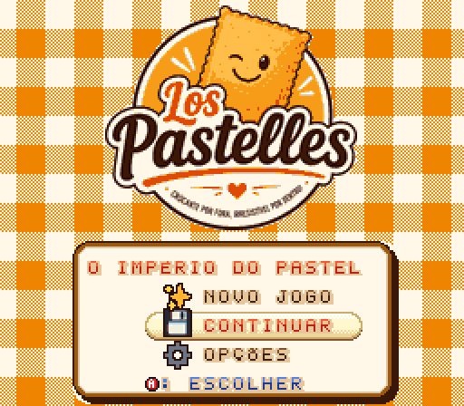
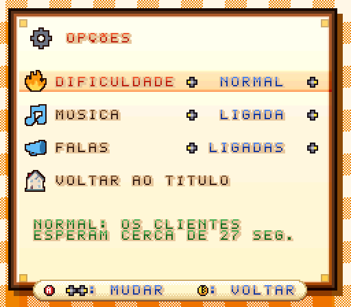
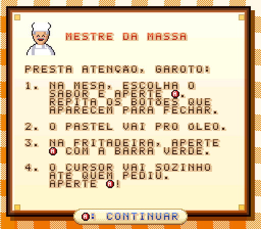
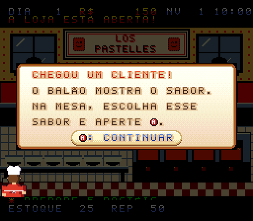
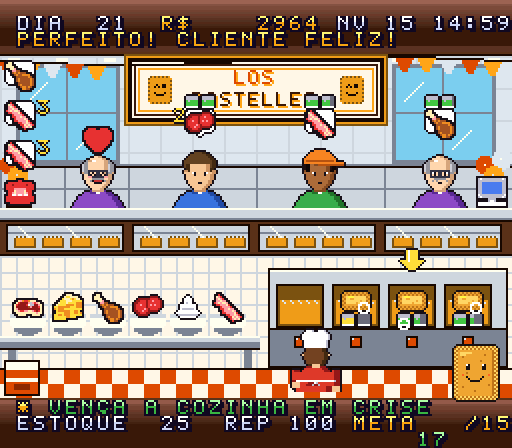
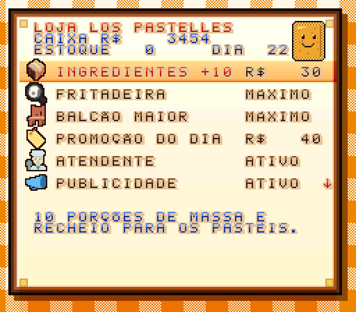

# Los Pastelles: O Império do Pastel

Jogo de gerenciamento de pastelaria para **Super Nintendo**, feito em assembly 65816.
Desenvolvido por **Ramon de Oliveira** — [www.lospastelles.com.br](https://www.lospastelles.com.br)

## Jogar
Baixe a ROM (`LosPastelles-<versão>.sfc`) da [versão mais recente](../../releases/latest)
e abra num emulador de SNES (Mesen, bsnes, Snes9x) ou grave num cartucho flash (EverDrive, FXPAK).
A versão aparece na tela de créditos. O [`LosPastelles.sfc`](LosPastelles.sfc) do repositório é a compilação de desenvolvimento.

| | | |
|:---:|:---:|:---:|
|  Título |  Opções |  História, com os botões do controle no texto |
|  Tutorial guiado |  Expediente (loja reformada) |  Loja entre os dias |

Com o título parado 30 segundos, começa uma demonstração em que a CPU joga um expediente.

Controles, conteúdo, segredos e instruções para gravar no cartucho estão no [LEIAME.md](LEIAME.md).
O manual está em [`cartucho/manual_los_pastelles.pdf`](cartucho/manual_los_pastelles.pdf) e o trailer em
[`trailer/trailer_los_pastelles.mp4`](trailer/trailer_los_pastelles.mp4).

## Recompilar
Requer Node.js, Python com Pillow e duas ferramentas que não acompanham o repositório:
- [cc65](https://cc65.github.io/) extraído em `tools/cc65` (o build usa `tools/cc65/bin/ca65` e `ld65`);
- [Mesen 2](https://www.mesen.ca/) em `tools/mesen` para jogar e em `teste/mesen` para os testes automáticos.

Depois é só rodar `node build.js` (sem `tools/cc65`, o build usa o `ca65`/`ld65` do PATH).
As vozes e a música (`sounds/*.mp3`) já vão convertidas para BRR em `arte_fonte/brr/`; o [ffmpeg](https://ffmpeg.org/) só é necessário ao trocar ou incluir um áudio.
Para lançar uma versão, suba o número no arquivo `VERSION`: ao chegar na `main` e passar nos testes, o release sai sozinho (ver `CLAUDE.md`).

Os ícones dos menus vêm do [Twemoji](https://github.com/twitter/twemoji) (CC-BY 4.0).
